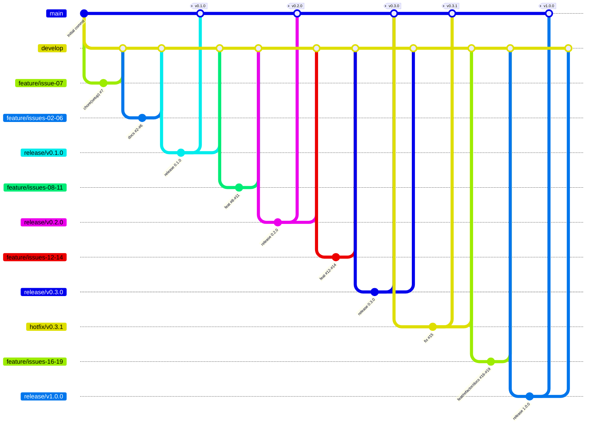

# TaskFlow CLI

[](https://github.com/JulianaPelozo/especificacao-gestao-SDLC/releases)
[](https://github.com/JulianaPelozo/especificacao-gestao-SDLC/actions/workflows/ci.yml)
[](LICENSE)
[](https://www.python.org/)
[](https://www.conventionalcommits.org/pt-br/v1.0.0/)

Mini-gerenciador de tarefas **de linha de comando**, escrito em Python e sem dependências externas.

## O problema

Quem passa o dia no terminal (estudantes de computação, desenvolvedores) costuma controlar as pendências em post-its, blocos de notas soltos ou ferramentas web pesadas, que pedem conta, internet e uma troca de contexto. Com isso, prazos são esquecidos e não há uma visão clara do que já foi feito.

O **TaskFlow CLI** resolve isso **dentro do terminal**: cadastre, liste, filtre, busque, edite, conclua e remova tarefas com um comando, e veja seu progresso em um resumo. Os dados ficam em um **arquivo JSON local e legível**, sem cadastro, servidor ou rede.

```
$ taskflow adicionar "Entregar relatório" --prioridade alta --prazo 2026-11-05
Tarefa 1 criada: Entregar relatório

$ taskflow listar --ordenar prioridade
ID  STATUS     PRIORIDADE  PRAZO        TÍTULO
--  ---------  ----------  -----------  ------
1   pendente   alta        2026-11-05!  Entregar relatório
2   concluida  media       2026-11-20   Revisar Programação
3   pendente   baixa       2026-11-12   Ler artigo sobre SemVer
3 tarefa(s).   (! = atrasada)

$ taskflow resumo
Resumo das tarefas
------------------
Total:       3
Pendentes:   2
Concluídas:  1
Atrasadas:   1

Progresso: [███████░░░░░░░░░░░░░] 33%
```

## Funcionalidades

| Status | Funcionalidade | Comando | Requisito | Issue | Versão |
|:---:|---|---|---|---|---|
| ✅ | Cadastrar tarefa (título, descrição, prioridade, prazo) | `adicionar` | RF01 | [#10](../../issues/10) | v0.2.0 |
| ✅ | Listar tarefas em tabela | `listar` | RF02 | [#11](../../issues/11) | v0.2.0 |
| ✅ | Filtrar por status e prioridade | `listar -s/-p` | RF03 | [#11](../../issues/11) | v0.2.0 |
| ✅ | Editar campos de uma tarefa | `editar` | RF04 | [#12](../../issues/12) | v0.3.0 |
| ✅ | Concluir e reabrir tarefa | `concluir`, `reabrir` | RF05 | [#13](../../issues/13) | v0.3.0 |
| ✅ | Remover com confirmação | `remover [--sim]` | RF06 | [#14](../../issues/14) | v0.3.0 |
| ✅ | Tratamento de arquivo de dados corrompido | — | RNF03 | [#15](../../issues/15) | v0.3.1 |
| ✅ | Buscar por palavra-chave (ignora acentos e maiúsculas) | `buscar` | RF07 | [#16](../../issues/16) | v1.0.0 |
| ✅ | Ordenar por ID, prazo ou prioridade | `listar -o` | RF08 | [#16](../../issues/16) | v1.0.0 |
| ✅ | Resumo com progresso e tarefas atrasadas | `resumo` | RF09 | [#17](../../issues/17) | v1.0.0 |
| 🗓️ | Exportar para CSV | `exportar` | RF10 | [#20](../../issues/20) | v1.1.0 (planejada) |

## Instalação e execução local

**Pré-requisitos:** [Python 3.10+](https://www.python.org/downloads/) e [Git](https://git-scm.com/).

1. **Clone o repositório**
   ```bash
   git clone https://github.com/JulianaPelozo/especificacao-gestao-SDLC.git
   cd especificacao-gestao-SDLC
   ```

2. **Crie e ative um ambiente virtual** (recomendado)
   ```bash
   python3 -m venv .venv
   source .venv/bin/activate        # Windows: .venv\Scripts\activate
   ```

3. **Instale o pacote** (modo editável; cria o comando `taskflow`)
   ```bash
   pip install -e .
   ```

4. **Use**
   ```bash
   taskflow --help
   taskflow adicionar "Minha primeira tarefa"
   taskflow listar
   ```

   > Para rodar sem instalar: `PYTHONPATH=src python3 -m taskflow listar`

5. **Rode os testes**
   ```bash
   PYTHONPATH=src python3 -m unittest discover -s tests -t . -v
   ```

### Referência de comandos

| Comando | Descrição |
|---|---|
| `taskflow adicionar "<título>" [-d DESC] [-p baixa\|media\|alta] [--prazo AAAA-MM-DD]` | Cadastra uma tarefa |
| `taskflow listar [-s pendente\|concluida] [-p PRIORIDADE] [-o id\|prazo\|prioridade]` | Lista, filtra e ordena |
| `taskflow buscar <termo> [-o CRITÉRIO]` | Busca no título e na descrição |
| `taskflow editar <id> [-t TÍTULO] [-d DESC] [-p PRIORIDADE] [--prazo DATA \| --sem-prazo]` | Altera campos |
| `taskflow concluir <id>` / `taskflow reabrir <id>` | Muda o status |
| `taskflow remover <id> [--sim]` | Remove (pede confirmação, a menos que use `--sim`) |
| `taskflow resumo` | Mostra contadores e progresso |

**Arquivo de dados:** `~/.taskflow/tarefas.json`. Para usar outro caminho, defina a variável `TASKFLOW_ARQUIVO`:

```bash
TASKFLOW_ARQUIVO=./estudos.json taskflow listar
```

**Códigos de saída:** `0` sucesso · `1` erro de uso/validação (ex.: ID inexistente) · `2` erro no arquivo de dados.

## Documentação

| Documento | Conteúdo |
|---|---|
| [Resumo do Projeto](docs/resumo.md) | Ideia do software e stack tecnológica, em dois parágrafos |
| [Termo de Abertura](docs/project-charter.md) | Justificativa, visão, objetivos SMART, escopo, stakeholders, riscos e marcos |
| [Requisitos](docs/requisitos.md) | RF01–RF10, RNF01–RNF09, regras de negócio e matriz de rastreabilidade |
| [Casos de Uso](docs/casos-de-uso.md) | Atores e UC01–UC07 com fluxos principais, alternativos e de exceção |
| [Histórias de Usuário](docs/user-stories.md) | US01–US08 com critérios de aceite em Gherkin |
| [Diagramas](docs/diagramas.md) | Diagrama de classes, modelo de dados, C4, sequência e wireframes |
| [Changelog](CHANGELOG.md) | Histórico de versões |

## Arquitetura

```
src/taskflow/
├── __init__.py      # versão do pacote
├── __main__.py      # permite python -m taskflow
├── cli.py           # interface: argparse, mensagens e códigos de saída
├── formatters.py    # apresentação: tabela e resumo em texto
├── services.py      # aplicação: casos de uso (TaskService)
├── models.py        # domínio: Tarefa, Prioridade, Status e validações
└── repository.py    # infraestrutura: JSON com escrita atômica
tests/               # testes unittest de cada camada
scripts/criar-backlog.sh   # cria labels, milestones e issues via GitHub CLI
```

Cada camada depende apenas da camada de baixo (`cli → services → repository/models`). Veja os diagramas C4 em [docs/diagramas.md](docs/diagramas.md).

## Fluxo de trabalho (Git Flow)

| Branch | Origem | Destino do merge | Finalidade | Exemplo |
|---|---|---|---|---|
| `main` | — | — | Produção: só recebe releases e hotfixes, cada merge recebe uma tag SemVer | `v1.0.0` |
| `develop` | `main` | `main` (via `release/*`) | Integração das funcionalidades prontas | — |
| `feature/issue-NN-descricao` | `develop` | `develop` | Uma branch por issue de funcionalidade/documentação | `feature/issue-10-cadastrar-tarefa` |
| `refactor/issue-NN-descricao` | `develop` | `develop` | Melhoria interna sem mudar comportamento | `refactor/issue-18-formatters` |
| `release/vX.Y.Z` | `develop` | `main` **e** `develop` | Preparar a versão (changelog e versão do pacote) | `release/v0.2.0` |
| `hotfix/vX.Y.Z` | `main` | `main` **e** `develop` | Correção urgente em produção | `hotfix/v0.3.1` |

Nunca há commit direto em `main`. Todo merge usa `--no-ff`, para que cada issue apareça como um bloco no histórico, e a mensagem de merge traz `Closes #N`.



> Simplificação: no histórico real, cada issue tem a sua própria branch (`git log --graph --oneline --all`).

### Convenção de commits

Seguimos [Conventional Commits](https://www.conventionalcommits.org/pt-br/v1.0.0/), sempre com a issue entre parênteses:

```
<tipo>(<escopo>): <descrição no imperativo> (#<issue>)
```

| Tipo | Uso | Exemplo real deste repositório |
|---|---|---|
| `feat` | Nova funcionalidade | `feat(cli): implementar comando remover com confirmação e flag --sim (#14)` |
| `fix` | Correção de bug | `fix(repository): detectar JSON corrompido e preservar cópia .bak (#15)` |
| `docs` | Documentação | `docs(requisitos): detalhar requisitos não funcionais RNF01–RNF09 (#3)` |
| `test` | Testes | `test(services): cobrir busca normalizada e ordenação por prazo e prioridade (#16)` |
| `refactor` | Mudança interna sem alterar comportamento | `refactor(formatters): extrair formatação de tabela e resumo para módulo próprio (#18)` |
| `chore` / `ci` | Build, versão, configuração | `chore(release): atualizar versão para 0.2.0` |

### Versionamento semântico

| Tag | Tipo | Marco |
|---|---|---|
| `v0.1.0` | minor | Documentação de planejamento e setup (#2–#7) |
| `v0.2.0` | minor | Modelo, persistência, cadastro e listagem (#8–#11) |
| `v0.3.0` | minor | Edição, conclusão/reabertura e remoção (#12–#14) |
| `v0.3.1` | **patch** | Hotfix: arquivo JSON corrompido (#15) |
| `v1.0.0` | major | Primeira versão estável: busca, ordenação, resumo e documentação final (#16–#19) |

Todas as tags são **anotadas** (`git tag -a`). Veja-as com `git tag -n`.

### Backlog

O backlog fica nas [Issues](../../issues), com labels (`documentation`, `feature`, `enhancement`, `bug`, `refactor`, `setup`) e milestones por versão. Cada issue traz seus critérios de aceite, extraídos das [histórias de usuário](docs/user-stories.md). O script [`scripts/criar-backlog.sh`](scripts/criar-backlog.sh) recria o backlog completo com a [GitHub CLI](https://cli.github.com/).

## Licença

Distribuído sob a licença MIT. Veja [LICENSE](LICENSE).

---

Desenvolvido por **Juliana Pelozo Pacheco** como atividade prática de Especificação e Gestão do Ciclo de Vida de Software (SDLC).
