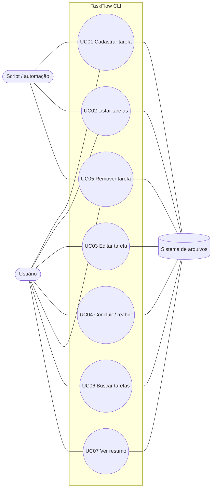

# Especificação de Casos de Uso — TaskFlow CLI

## 1. Atores

| Ator | Tipo | Descrição |
|---|---|---|
| **Usuário** | Primário (humano) | Pessoa que usa o terminal para organizar suas tarefas. Inicia todos os casos de uso. |
| **Script / automação** | Primário (sistema) | Script de shell ou agendador que chama o `taskflow` sem interação (ex.: `--sim`) e lê os códigos de saída. |
| **Sistema de arquivos** | Secundário (sistema) | Armazena o arquivo JSON de dados. Pode estar indisponível, sem permissão ou com conteúdo inválido. |

## 2. Diagrama de casos de uso

