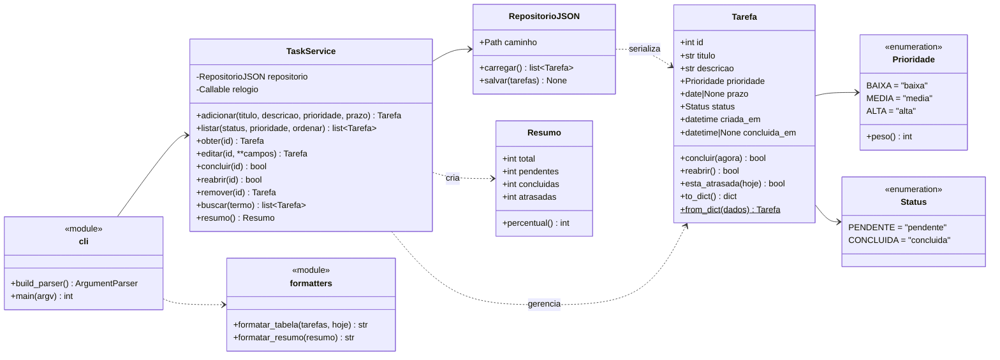

# Diagramas de Engenharia — TaskFlow CLI

Os diagramas usam [Mermaid](https://mermaid.js.org/), que o GitHub desenha direto no navegador.

## 1. Diagrama de classes

**Exceções do domínio:** `ValidacaoError` (dados inválidos → código 1), `TarefaNaoEncontradaError` (ID inexistente → código 1) e `ArquivoCorrompidoError` / `RepositorioError` (problemas no arquivo → código 2).

